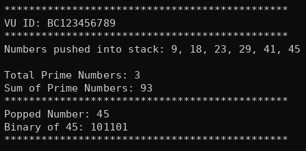

# Custom Stack Implementation in C++ (Prime Filtering & Binary Conversion)


A clean, memory-safe custom data structure implementation in C++ featuring a linked-list-based Stack (**LIFO**). This project demonstrates hands-on implementation of memory management, pointer manipulation, algorithmic number filtering, and low-level number parsing.

## Features

- **Custom Stack Architecture:** Built completely from scratch using a custom `Node` class without relying on `<stack>` or standard collection libraries.
- **Dynamic Memory Management:** Features a fully manual, leak-free destructor pattern to safely deallocate heap-allocated memory components.
- **Prime Number Tracking:** Extracts data filters to evaluate, count, and sum mathematical prime numbers dynamically.
- **Base-10 to Binary Converter (`toBinary`):** Converts integers into binary visual equivalents using stack-reversal arithmetic and placeholder column generation.

---

## Core Engineering Highlights

### The Column Displacement Algorithm (`digit_place`)
Instead of using heavy string manipulation or structural format vectors, the binary conversion utilizes an elegant mathematical place-value reconstruction trick. By tracking base-10 numerical columns dynamically, bits are popped into their exact visual columns smoothly:

```cpp
// Reconstructing bits into a single integer using mathematical columns
while (pop_val != -1) {  
    binary_number += pop_val * digit_place;
    digit_place *= 10; // Shifts columns: 1 -> 10 -> 100 -> 1000
    pop_val = binary_stk.pop();
}
```

### Secure Separated-Duty Deallocation
Memory deallocation separates responsibilities cleanly. The passive `Node` structure delegates tracking to the `NumberStack` container manager, which cleans up individual nodes systematically to avoid cascading crashes or dangling pointer references:

```cpp
~NumberStack() {
    Node *temp = head;
    while (head != nullptr) {
        head = head->getNext(); 
        delete temp; // Deletes the physical node block safely
        temp = head;
    }
}
```

---

## Sample Output Preview

```text
VU ID: BC250411080
Numbers pushed into stack: 0, 18, 23, 29, 41, 45
Total Prime Numbers: 3
Sum of Prime Numbers: 93
Popped Number: 45
```

---

## Compilation & Execution

Compile using any standard C++ compiler (C++11 or newer recommended):

```bash
g++ main.cpp -o stack_app
./stack_app
```
